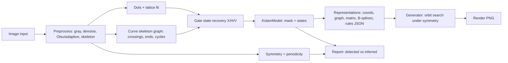

# Kolam Design Analysis & Recreation — Design Document

## 1. Proposed solution
Treat a pulli kolam as a **loop model on a dot lattice**. Every dot is ringed by 4 short segments; at each
"gate" (midpoint between two neighbouring dots) the artist chooses one of three ways to pair the four
strands: **X** (cross), **H** or **V** (bounce). Following the pairings splits the drawing into closed loops;
a one-stroke (sikku) kolam has exactly one. So a kolam = *dot mask + one symbol per gate*.
- **Analysis** recovers that description from pixels (dots → lattice → gate states → loops/symmetry).
- **Generation** searches gate states under a symmetry constraint to reach a target loop count.
Explainable image processing and geometry only; no pretrained model.

## 2. Feasibility
| Part | Feasibility | Status |
|---|---|---|
| Dot detection, lattice fit (square, rotated, masks) | High on clean images | implemented, tested (synthetic) |
| Gate-state recovery | High if lattice is right and ≥ ~12 px per half-spacing | implemented, tested (synthetic) |
| Symmetry (pixel level) | Medium: dense patterns overlap by chance | two-tier scores + chance baseline |
| Hexagonal/triangular lattices, dot-less freehand kolams | Low–medium | detected/reported only |
| Real photographs (perspective, shadows, chalk texture) | Unknown | **untested** |

## 3. Mathematical principles identified computationally
Dihedral symmetry (mirror axes, rotation order) · translational periodicity (autocorrelation, gate-state
periods) · lattice geometry (basis vectors, angle, ratio) · topology (Euler/cyclomatic number
β₁ = E − V + k, crossings, end points, loop count) · graph structure (adjacency matrix) · parametric curves
(quadratic B-splines) · fractal-like complexity (box-counting dimension) · combinatorics (3^gates states).

## 4. Architecture

Data flow: `uint8 image → binary/skeleton → dot centres → lattice (a1,a2,origin,mask) → gate states → loops → descriptor → new mask+states → loops → image`.

## 5. Algorithms and libraries per module
| Module | File | Algorithms | Libraries |
|---|---|---|---|
| 1 Input | io_utils.py | EXIF fix, alpha compositing | Pillow, OpenCV |
| 2 Preprocess | preprocess.py | median+Gaussian, Otsu, separability test, adaptive fallback, border polarity, thinning | OpenCV, scikit-image |
| 3 Dots/lattice | dots.py | component shape tests, opening fallback, direction histogram, integer rounding + least squares | OpenCV, SciPy |
| 4 Analysis | symmetry.py, topology.py, rules.py | tolerant overlap under reflections/rotations, FFT autocorrelation, skeleton multigraph, spur pruning, disc-connectivity gate test | NumPy, NetworkX |
| 5 Representation | representation.py, curves.py | coordinate/graph/matrix/B-spline/rule forms | NetworkX, SymPy |
| 6 Generation | generator.py, groups.py | orbit union-find with H/V parity, annealing-style loop minimisation, tiling | NumPy |
| 7 Visualisation | visualize.py, render.py, app.py | 8-panel figure, PNG export | Matplotlib, Streamlit |

Per-algorithm purpose, maths, inputs/outputs and limits are in each module's docstring.

## 6. Roadmap (phases 1–9)
1 Research (done: loop-model literature framing) → 2 Architecture (this doc) → 3 Preprocess + dots (done) →
4 Symmetry/topology (done) → 5 Representations (done) → 6 Generator (done) → 7 UI (done) →
**8 Test on real kolam photos (TODO — needs your images)** → 9 Evaluate/tune thresholds on those.

## 7. Challenges and solutions
| Challenge | Handling |
|---|---|
| Uneven light / either colour scheme | polarity from border; adaptive threshold when Otsu separability < 0.5 |
| Dots touching curves | opening-based fallback |
| Rotated or tilted drawings | lattice basis from neighbour-vector histogram; symmetry scanned over all angles |
| Pixel symmetry blind to small gate differences | two thresholds + exact lattice-level symmetry on recovered states |
| Single stroke unreachable under some symmetry | search reports best loops and `achieved=False` |
| Perspective photos | not handled (would need homography from the dot lattice) |

## 8. Research questions — short answers
1. Symmetry, periodicity, lattice order, closed loops, crossings. 2. Overlap score under T(A) with tolerance and chance baseline.
3. Blob filtering + neighbour-vector lattice fit. 4. Quadratic B-splines through gate nodes.
5. Each dot's 4-segment ring; gates choose X/H/V. 6. Autocorrelation peaks; state-period test.
7. Mask + symmetry group + state weights + target loops → search. 8. `evaluation.py` checklist (heuristic, not artistic judgement).

## 9. Measured findings (this build, synthetic data)
Minimum loops reachable by the generator (all seeds agree): square 5/6/7 under full D4 → 5/6/7 loops (never 1);
diamond 7 D4 → 3; cross 7 D4 → 3; octagon 7 D4 → 5; rect 4×6 with two mirrors → 2.
With only 90° rotation, one stroke was reached in 10/10 runs (5×5). So in this model full mirror
symmetry and a single stroke are incompatible on those grids; rotational (C4) or C2 symmetry is the route to sikku designs.
